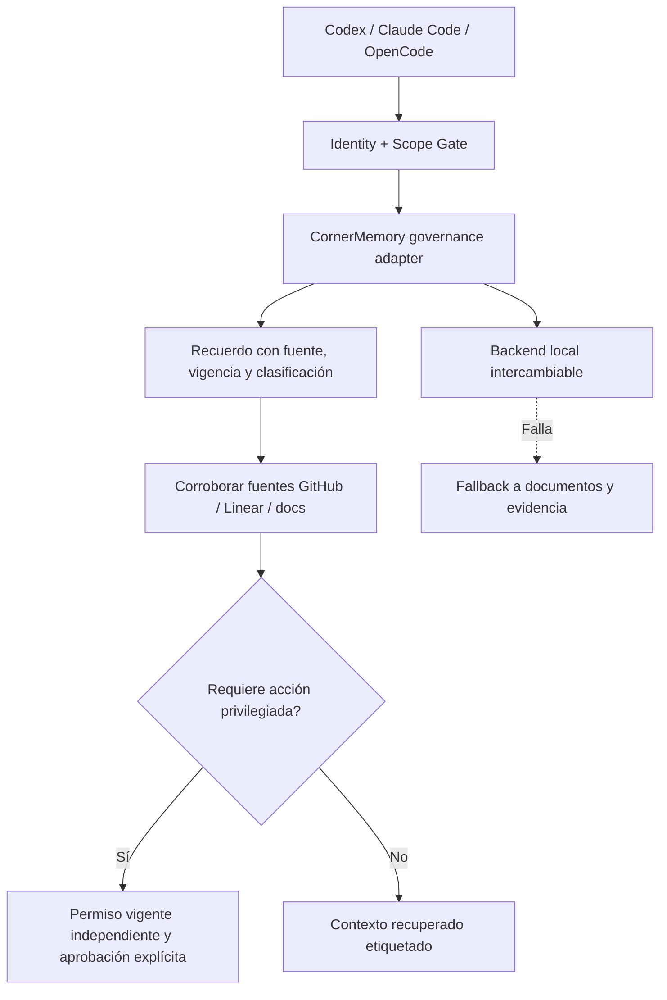

# CornerTech AI · Integration Decision Register para Agent Memory Governance v0.2

**Estado:** FOUNDER APPROVED como registro de criterios y decisiones de investigación (2026-11-09, ECOSYSTEM-DEC-002). **Fecha de análisis:** 2026-11-08. **Destino:** anexo de diseño, NO autorización de proveedores, implementación ni norma operativa autónoma.  
**Base:** dos informes Deep Research leídos por el Founder, Execution Standard 1.0, CT-WCOS v1.1, AGENTS.md, CLAUDE.md y estado de GitHub (consulta 2026-11-08).

## Selección de valor

| Fuente o patrón | Qué aprovechar | Dictamen | Dónde integrarlo | Evidencia pendiente |
|---|---|---|---|---|
| Engram | Enfoque local-first, recuerdos concisos, búsqueda de texto, procedencia y bajo costo de operación | **ADOPTAR principio; EXPERIMENTAR motor** | §§3–6, 11 | Verificar implementación, APIs, seguridad, licencia y límites actuales en repositorio real |
| Claude-Mem | Captura selectiva, continuidad entre sesiones y recuperación progresiva | **ADOPTAR patrón, no captura indiscriminada** | §§3, 6, 8 | Riesgos de hooks, consentimiento y filtrado de datos |
| Mem0 | Extracción/consolidación estructurada y recuperación semántica | **EXPERIMENTAR** | §§5–6, 10–11 | Benchmarks independientes y costos de embeddings/modelos |
| Graphiti/Zep | Vigencia de hechos y grafo temporal de contradicciones | **ADOPTAR campos temporales; DIFERIR grafo** | §§4–5, 11 | Demostrar consultas temporales imposibles o difíciles con baseline |
| LangMem | Políticas de consolidación, namespaces e interfaces componibles | **ADOPTAR ideas de interfaz; NO acoplar framework** | §§4–6, 11 | Validar separación de acceso real y compatibilidad con nuestras herramientas |
| Letta | Memoria de trabajo vs larga duración, agent identity y estado recuperable | **ADOPTAR modelo conceptual** | §§3–4, 8 | Verificar si usar harness completo genera más carga que valor |
| MemMachine y afines | Separación de memoria episódica, perfil y trabajo | **ADOPTAR taxonomía, DIFERIR cloud** | §§3, 7, 11 | Due diligence seguridad, precio y data residency si se reconsidera SaaS |
| IAI-PME y similares | Recuperación por múltiples señales y detección explícita de contradicciones | **EXPERIMENTAR patrón de anti-hits** | §§5–6, 10 | Validación independiente, licencias, complejidad y performance |
| Código/docs/GitHub/Linear actuales | Fuente de verdad, evidencia real, rollback y baseline sin memoria | **CONSERVAR como autoridad** | §§1, 8, 10 | Establecer dataset baseline y medir recuperación actual |
| CornerMemory propio | Control de admisión, autorización, proveniencia, temporalidad y adapters | **DISEÑAR contrato mínimo, NO motor nuevo todavía** | §§4, 6–8, 11 | ADR comparativo posterior al piloto |

## No incorporar automáticamente de los informes

1. **Una nube como backend primario.** Uno de los informes recomienda combinar almacenamiento local y MemMachine/Mem0 Cloud desde el principio. Eso aumentaría superficies de fuga y costos antes de demostrar una necesidad; **diferir**.
2. **Afirmaciones incompatibles sobre Engram.** Un informe lo describe como Go + SQLite/FTS5; el otro como servicio Python/FastAPI + Qdrant y recuperación vectorial. Son incompatibles como descripción de un mismo estado técnico. **Verificar código y versión** antes de escribir requisitos técnicos o comandos.
3. **Captura completa e inmutable de prompts/respuestas.** No garantizaría privacidad, calidad ni borrado. **Permitir solo captura minimizada y con política de retención**.
4. **Solo namespaces para aislamiento.** Un campo `user_id`/`project_id` no equivale a autorización. **Requerir identidad confiable, política de lectura y pruebas negativas**.
5. **Actualizar el Execution Standard para registrar cada recuerdo.** Generaría burocracia y una segunda evidencia. **Mantener un enlace opcional al recuerdo, no un nuevo control obligatorio**.
6. **Promesas de métricas o fechas sin evidencia.** No afirmar porcentajes de ahorro, costos mensuales, fase `done`, cronogramas ni resultados de pilotos no ejecutados. Medir antes.
7. **No poder borrar episodios por inmutabilidad.** El borrado seguro y las obligaciones de privacidad tienen prioridad. Implementar tombstones/linaje si hace falta, sin retener el contenido prohibido.
8. **Licencias y características de vendors como hechos corporativos.** Comprobar fecha, versión y fuente primaria; las licencias pueden variar entre proyectos, módulos y planes.

## Arquitectura candidata para el piloto

La arquitectura es conceptual y no presupone soporte de ningún motor ni conectividad automática a GitHub/Linear.

## Handoff de trabajo preparado (sin autorización de escritura remota)

**Codex: diseño/implementación preparada.** Leer `AGENTS.md`, `CLAUDE.md`, Execution Standard 1.0, CT-WCOS v1.1 y PR #110 para evitar solapamientos. Examinar `docs/governance/` y verificar si existe una política de memoria actual; si no, tomar el borrador v0.2 como nuevo documento propuesto. Preparar diff local, contrato de memoria, casos negativos y ADR que separe gobernanza de selección de motor. **No push, PR, merge, instalación, sincronización ni acceso a datos reales sin permiso.**

**Claude Code: revisión independiente proporcional al riesgo.** Comparar el diff contra los estándares corporativos; revisar reglas de aprobación, aislamiento y borrado, ausencia de claims falsos, no duplicación de controles, compatibilidad con PR #110 y evidencia exacta por SHA. Emitir PASS/REVISE/BLOCKED con hallazgos accionables. No declarar revisión completada hasta ejecutarla.

**Aceptación deseada:** un solo documento normativo propuesto, un registro liviano de decisiones tecnológicas separado, suite de casos positivos y negativos propuesta, y autorización por alcance antes de cualquier modificación remota.

**Ruta corporativa deseada:** `docs/governance/agent-memory-governance.md` + `docs/research/agent-memory-integration-decisions.md` tras revisión y aprobación de creación. Si el repo usa otras convenciones, prevalece la estructura real observada.

## Corporate publication note · 2026-11-09

Research and technical-selection criteria approved by the Founder under ECOSYSTEM-DEC-002; backend/vendor choices remain subject to verification and explicit authorization. This record is proposed in Draft PR #111 and has no runtime effect. References to PR #110 in historical handoff text are superseded because PR #110 merged at `c59e17034ea37ab4556214ff43b05a59f97405b9`.
